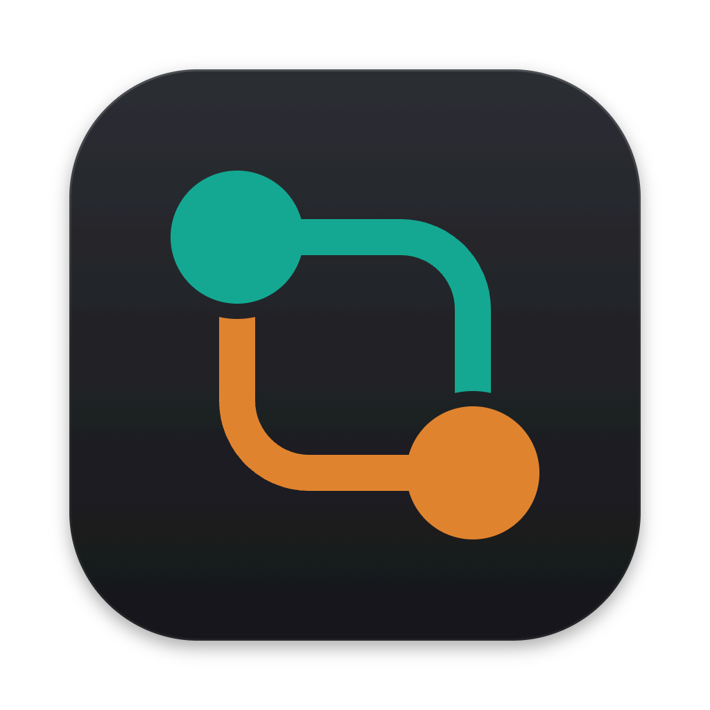

# agentduo

A channel between two coding agents. **Codex** plans and reviews; **Claude Code** critiques the plan and implements it. agentduo relays their structured messages, runs the loop, and shows in a live terminal UI what each agent is doing and what they hand each other.

agentduo adds no rules of its own: permissions, sandboxes and conventions come from each CLI's configuration and your repository's `AGENTS.md` / `CLAUDE.md`.

Website: [agentduo.netlify.app](https://agentduo.netlify.app/) · Tiếng Việt: [docs/README.vi.md](docs/README.vi.md)

```text
● PLAN r1  Codex (planner)                                      32s · 33k tok
  │ exec  rg --files ✓
  └ Codex → Claude  Plan v1 "Add subtraction" · 3 steps · 6 criteria · 1 risks

● PLAN_REVIEW r1  Claude (plan critic)                          48s · $0.17
  │ Read  src/calc.ts ✓
  └ Claude → Codex  approved · 2 suggestion(s)
──────────────────────────────────────────────────────────────────────────────
 PLAN ✓ › CRITIQUE ✓ › FINALIZE ✓ › IMPLEMENT ● r1 › VERIFY › REVIEW    plan 1/4 · impl 1/5
 ⠋ Claude (implementer) · 0:21
   │ Edit  src/calc.ts  +4 −0 ✓
 $0.33 · 67k tok                  [v] details  [q] stop after this step  [ctrl-c] stop now
```

## How it works

1. **Plan and debate.** Codex writes a plan with goals, scope, steps, acceptance criteria and risks. Claude checks that it is feasible, Codex revises it, and Codex finally signs it off.
2. **Implement and review.** Claude implements the plan. Optional quality gates run, and their results go to the reviewer. Codex reviews the diff, and Claude fixes the findings, round after round, until the run reaches `DONE`.

A run reaches `DONE` when all of these hold for the code in your workspace at the end, not for an earlier revision of
it:
- Codex approves that code;
- no blocking finding is left;
- if you configured gates, every required gate passes on that code, with the gate configuration as it is then.

The only way past one of these is your own decision to accept a pre-existing failure. `DONE` then says *with accepted
exceptions* and names them; an accepted failure is never reported as a pass. With no gates configured, `DONE` says
that nothing was verified automatically.

**DONE is checked against the final code.** Just before `DONE`, agentduo compares the workspace with what the gates
and the review were about: the files (dirty, untracked and deleted ones included) and the gate configuration. It
checks again on a resume, since you may have edited files while the run waited. When nothing changed, nothing runs
again. When only the gate configuration changed, the gates run again and the review's approval stands. When the code
changed after the approval (your edits, a tool, the reviewer's own edits, a gate that writes files), the gates run
again and the code is reviewed again. If the files keep changing, the run stops after two such refreshes in a row
with `verification_stale` instead of ending on evidence about other code. The record of what `DONE` rests on is
`verification.json` in the run directory, and `duo status` and the report show it. The design is in
[docs/superpowers/specs/2026-11-03-agentduo-final-verification-design.md](docs/superpowers/specs/2026-11-03-agentduo-final-verification-design.md).

**Pipeline profiles.** A profile sets how much planning and review a run spends, never what it checks. You choose it
with `pipeline.profile` in the config, `duo --profile <name> "<task>"`, or `/pipeline --profile <name> <task>` in the
chat:

- `lightweight`: for small, clearly specified tasks. A plan the critic approves goes straight to implementation,
  without the planner's sign-off, and the planner is asked for a short plan. If the task turns out bigger, the run moves
  to `standard`, keeping everything it did. The signals: a plan of more than 6 steps or 8 files, a critique that sends
  the plan back, a contradiction or scope change, a blocker, 3 or more files changed that the plan never names,
  required gates failing twice in a row, a second review that still blocks, a stalled review loop, or a critical
  finding.
- `standard`: the pipeline as before, and the default.
- `thorough`: for complex or risky tasks. The planner always signs off, a review runs even when gates fail, and the
  planner, critic and reviewer are asked to go in depth.

Every profile keeps the critique, the independent review, the required gates, the final verification, the scope and
consistency checks, the loop breakers, the budget and your decisions. A run keeps its profile on resume; only an
escalation changes it, and only upward. On the same small task, lightweight makes 4 agent calls where standard makes 5,
or 8 when standard's sign-off sends an approved plan back. `metrics.json`, the report and `duo status` show where the
calls, tokens and rounds went, and why a run escalated.

**Planning that does not converge stops.** agentduo tracks the critic's issues across critiques, also when they are
renumbered or reworded. When two critiques in a row block on the same issues (or the planner returns the same plan),
the run stops with `planning_stalled` instead of using up its planning rounds. *Implement latest plan* (`resume`)
implements it as it is, recorded as accepted by you; `revise` with a note re-plans. The design is in
[docs/superpowers/specs/2026-11-03-agentduo-profiles-design.md](docs/superpowers/specs/2026-11-03-agentduo-profiles-design.md).

When a limit is reached, an agent fails or blocks, or a critical finding appears, the run asks you what to do.

**Requirements that cannot all hold.** Before the first plan, agentduo runs your gates once, to learn what already
fails before any change. The plan must say, for each required gate that fails then, whether it fixes it. The critic
checks the plan against the task, its scope and that baseline, and lists contradictions that only you can settle,
such as a criterion that needs something the task puts out of scope. A contradiction, or a required gate that the plan
leaves failing, stops the run before any implementation (`requirements_conflict`). After implementation, the
reviewer gives, for every blocking problem, where it comes from and the evidence for it: the change caused it, or it
was there before and lies outside the plan's scope. If all that still fails is pre-existing and outside the scope,
another fix round could not settle it, so the run asks you (`preexisting_failures`) instead of looping. The task's
requirements are never changed for you, and no failure is waived without your decision. What you accept is the failure
as it was before the task: every later review still attributes that gate, and a failure the change made worse, or a
gate whose command changed, is the task's to fix again. The design is in
[docs/superpowers/specs/2026-11-03-agentduo-acceptance-design.md](docs/superpowers/specs/2026-11-03-agentduo-acceptance-design.md).

**The task's scope does not grow on its own.** The plan's acceptance criteria have ids (`AC1`, `AC2`, …). With the
plan's scope they are the task's contract, and once implementation starts only your `revise` changes them. The
reviewers classify what they report against that contract:

- *Findings the task must fix*: a regression the change causes, or an `in_scope` finding that names the criteria it
  fails (agentduo checks that those criteria exist).
- *Pre-existing failures*: problems that were there before the task.
- *Out of scope*: improvements or concerns beyond the task. These are suggestions. They never block, and the
  implementer is not asked to act on them. A review or critique that withholds approval on them alone is asked again.

Two things widen the scope, and each stops the run for your decision:

- A critical problem outside the scope, which the reviewer must justify (`out_of_scope_critical`).
- A revised plan that adopts a suggestion the critic marked out of scope (`scope_expansion`).

The design is in
[docs/superpowers/specs/2026-11-03-agentduo-scope-design.md](docs/superpowers/specs/2026-11-03-agentduo-scope-design.md).

### What each agent is given

Each role (planner, plan critic, implementer, code reviewer) keeps one CLI session for the whole run. When one CLI
plays both the plan critic and the implementer (the default: Claude), they keep one session between them.

- **First call:** the full picture. That is the task, the chat before it, your notes and what earlier agents
  recorded.
- **Later calls:** they continue that session (`claude --resume`, `codex exec resume`) and get only what is new. That
  is the files changed since the role's last turn, your new notes, and the work to act on. The reviewer, for example,
  gets the diff since the revision it last reviewed. So a fix round does not re-read the repository from scratch.
- **Plan sign-off** continues the planner's session.
- **The implementer goes on in the plan critic's session**, so it starts from what the critic read and judged. Its
  first turn is told it is the implementer now, and gets the final approved plan whole, how it became final, and what
  changed since the critic's last turn. On two different CLIs, or when one of the two has sessions turned off in its
  `role_args`, each keeps its own (or none).
- **No other session passes from one role to another**, so the reviewer never sees the implementer's reasoning.

The planner, critic, implementer and reviewer also leave short notes about the repository: what a file holds, a
convention, the test command. Each note names its file or folder. Later roles get the notes that still hold: a note
is dropped once anything under its path changes. A role never gets the notes of the agent whose work it judges. The
plan critic gets none of the planner's, and the code reviewer none of the implementer's.

Review findings stay tied to the code they are about. Each one names the revision its review was of. Once the
implementer answers a finding (`fixed`, `disputed`, `not_applicable`), it is not asked about it again until the next
review checks the answer. That holds even when the attempt that answered it ended blocked, or the round's gates then
failed. A finding whose file changed since its revision is marked as possibly out of date. When an attempt is re-run,
it is told what the earlier attempt left in your files, so it goes on from there instead of starting over. Before the
gates run, and before a review, agentduo takes the workspace as it is now, including edits you made while the run
waited. If the gates passed on an earlier revision or with another configuration, they run once more first, so a review
rests on gated code. If the files keep changing even after that, the review gets the earlier results with a warning,
and `DONE` waits until the gates have run on the code it ends with.
The design is in
[docs/superpowers/specs/2026-11-03-agentduo-review-state-design.md](docs/superpowers/specs/2026-11-03-agentduo-review-state-design.md).

If a CLI has lost a session, the call starts a fresh one with the full prompt, without spending a retry. Kept sessions
show up in each CLI's own session list. To start every call afresh instead, put `--no-session-persistence` in
`claude.args` or `--ephemeral` in `codex.args` (or in `role_args` for one role). The design is in
[docs/superpowers/specs/2026-11-03-agentduo-context-sharing-design.md](docs/superpowers/specs/2026-11-03-agentduo-context-sharing-design.md).

## Requirements

- Node.js ≥ 22.12 and git. A pipeline run (`duo "<task>"`, `/pipeline`) snapshots and diffs your files with git, in
  your repository or, in a folder that has none, in a repository of agentduo's own (see
  [Folders without a git repository](#folders-without-a-git-repository)): no `git init` needed. The chat and `/discuss`
  work in any folder, also without git.
- [Codex CLI](https://developers.openai.com/codex/cli/): run `npm i -g @openai/codex`, then `codex login`.
- [Claude Code](https://code.claude.com/docs/en/overview): the `claude` command. If it is installed only through the VS Code, Cursor or Windsurf extension, agentduo finds the bundled binary.

## Install and quick start

```bash
npm i -g agentduo
cd my-project            # or any subdirectory: that directory is the workspace
duo init                 # .agentduo/config.yaml (everything optional) and .agentduo/.gitignore
duo doctor               # checks the CLIs and config; no model calls
duo                      # opens the chat
```

`agentduo` is the same command as `duo`. Use `agentduo` if another tool already owns the name `duo`.

## Chat

Run `duo` (or `agentduo`) without a task in a terminal. The chat is a three-way conversation between you, Claude Code
and Codex; the full pipeline runs only when you ask for it:

```
agentduo 0.5.0 · chat
› /claude What would it take to add refresh tokens here?
◆ Anthropic · Claude Code · default → sonnet (claude-sonnet-…)
  … Claude's whole answer, paragraphs and code as written …
› Is that plan safe for the existing sessions?
⬡ OpenAI · Codex · default → gpt-5.5 (codex doctor)
  … Codex answers, with Claude's answer in its context …
› /pipeline Add refresh tokens as discussed
── run 20261027-101500-add-refresh-tokens ──
  … Codex plans, Claude critiques, Claude implements, Codex reviews …
```

- **A message** goes to the agent named under the input: Codex in a new chat, then whoever you picked last.
  `/claude <question>` and `/codex <question>` ask one of them directly; `/claude` or `/codex` alone switches who your
  next messages go to. Each answer is shown whole, once, with the provider's mark (Anthropic / OpenAI) and the model it
  ran on. Both agents see the whole conversation (up to 120,000 characters of it; older exchanges are dropped whole, and
  the chat says so).
- **`/pipeline <task>`** runs the full workflow (plan → critique → finalize → implement → verify → review). Every role
  is told what was said in the conversation before the task, and what earlier pipeline tasks of the chat did.
  `/pipeline --profile lightweight <task>` runs it with another [profile](#how-it-works) than the config's.
- **`/discuss <question>`** has both agents work out one answer. The agent named under the input answers, the other
  reviews it and ends with `VERDICT: AGREE` or `VERDICT: REVISE`, and the first revises until the reviewer agrees, for
  at most `limits.max_discussion_rounds` reviews (3 by default; a review without a verdict counts as REVISE). Then
  Codex, in a call of its own, synthesizes the whole discussion into the final answer. It keeps what holds up from both
  agents, adds the points of the reviews the last version still misses, and leaves out what the discussion showed to
  be wrong. If the last review still asked for changes, the answer ends with a short section on what is still
  disputed. Codex always writes the synthesis, so when Codex also answered, the synthesis comes from the same model, in
  a resumed session asked to be neutral. A discussion makes 3 to 2N+1 agent calls, N being the review limit, plus one
  for each step asked again in a new session (see conversation sessions below). Each turn is
  shown as it ends (in the terminal by its first lines; `--verbose` shows them whole), then the final answer, whole.
  Only that answer joins the conversation, as Codex's answer discussed with Claude. If the synthesis fails, a warning
  says so and the latest version is the answer, from the agent that wrote it.
- **A message while the pipeline works** is a note: every step from the next one on carries it. `/claude`, `/codex`,
  `/pipeline` and `/discuss` say the workspace is busy instead; only one agent call runs at a time.
- **Esc** stops what runs. A stopped answer or discussion just ends, and nothing of it joins the conversation. A stopped pipeline step stays resumable: `/resume [note]`
  re-runs it (Enter on an empty line only reminds you). `/pipeline` while a run is stopped starts a new one; the stopped
  one keeps its id and stays resumable. `/new` forgets the conversation and starts over.
- **Conversation sessions.** Each conversation keeps one Codex session and one Claude session, shared by ordinary
  messages and every `/discuss` step, including synthesis. Reopening the same conversation resumes them; `/new` or a
  new conversation starts new sessions. Continued calls receive new exchanges and discussion messages (when those no
  longer fit what a prompt carries, the prompt says how many it leaves out). A continued call that fails is asked again
  once in a new session with the whole conversation, and a warning says so; one that timed out or went silent just
  fails. A failed or stopped answer leaves no session to continue, nor does a discussion that ends without an answer,
  for either agent: nothing of it is continued. Pipeline sessions remain separate by role. Explicit `--ephemeral` or
  `--no-session-persistence` in the backend's `args` disables conversation session reuse for that backend.
- **Models.** The input shows both agents' models. Before the first answer agentduo looks them up locally, without a
  model call: Codex's with `codex doctor --json` (with your `-c`/`--enable`/`--disable` overrides; a `--profile` is not
  something doctor takes, so the model then shows as unresolved, with the reason), Claude's from `--model`,
  `ANTHROPIC_MODEL` and Claude Code's settings files. A settings alias shows as `default → sonnet (configured alias)`
  until Claude's first answer names the exact model. Each question and run looks again, so an edited
  `~/.codex/config.toml` or Claude settings file shows from the next one.
- **Typing `/`** opens a list of the commands and their words, each with what it does, filtered as you type: Up/Down
  picks, Tab or Enter fills it in, Enter again sends, Esc closes the list.
- **Permission prompts and decisions** appear in place of the input line.
- **`/usage`** opens a panel in place of the input, like Claude Code's own `/usage`: each agent's account (plan and
  email), how much of its plan's limits it has used, with a bar per limit and when it resets, then Claude's "What's
  contributing to your limits usage?". Neither lookup calls a model: Claude's is `claude -p /usage`, with
  `claude auth status` for its account; Codex's comes from `codex app-server` (`account/read`
  and `account/rateLimits/read`, as Codex's IDE extension asks it, with your `-c`/`--enable`/`--disable` overrides),
  because Codex's own `/status` exists only in its TUI. The panel opens at once and each agent's part fills in as it
  answers (in about two seconds; each gets 15 s); if one fails, only its part says why. ↑↓ scroll it, `r` looks again,
  and Esc closes it and nothing else: an answer under way goes on. `/status` is unchanged.
- **Attached files.** `/attach <path>` attaches one file of any kind (images, PDFs, text, code…) to your next message,
  question, `/discuss`, `/pipeline` task or note. Quote a path with spaces or escape them, the way the shell reads one word:
  `/attach "~/Desktop/My notes.pdf"`, `/attach shots/bug\ 2.png`. A literal `'` goes in double quotes (`"it's.png"`);
  `'it''s'` reads as `its`, as in the shell. A relative path starts from the workspace, `~/` from your home directory,
  quoted or not (`\~` or `./~` for a folder named `~`); nothing is globbed or expanded. On Windows a backslash separates
  folders and escapes nothing, so a path with spaces goes in quotes (`/attach "C:\Users\me\My notes.pdf"`), and `~\` is
  your home directory too. `/attachments` lists the waiting files, `/detach <n|all>` removes them. Enter on an
  empty line sends the files alone (to the agent named under the input, or as a note while the pipeline works). The
  terminal does not read images from the clipboard: save the image, then `/attach` it.
  - agentduo copies each file, bytes unchanged, into `.agentduo/runs/conversations/<id>/attachments/` (a pipeline task's
    into its run's `attachments/`, so `/resume` needs neither the original nor the chat), and never into a snapshot.
    Limits: 20 files, 20 MB per file and 50 MB per message. A file waiting to be sent is dropped by `/new` and when the
    chat closes; a sent one stays.
  - Every prompt lists the files with the paths of their copies, so both agents can read them with their own tools
    (whether they can make sense of a given binary file is up to them). PNG, JPEG, GIF and WebP images also go to the
    model as images: to Claude as image blocks of a `stream-json` message, to Codex with `--image=<path>`. Claude takes
    at most 20 images per call, each up to 8000 pixels on a side and 5 MB once base64-encoded, and 20 MB of them in all;
    an image past those (or one agentduo cannot read the size of, or an SVG) goes as a path only, and a warning says so.
  - Images are sent again with every call of a `/discuss` and of a pipeline (each step, retry and repair is a call of
    its own), which costs tokens and time each time. A later question only lists an earlier message's files by path.
  - At a HUMAN_REVIEW decision, waiting files do not go with the decision: send them with a message first (a note for
    the run's next step), or decide later and `/resume` with a note.
- **Tagging workspace files with @.** Type `@` in the input and a list of the workspace's files and folders opens (the
  top level, folders first); type more and it narrows to the paths that have those letters in order, best first, as a
  quick-open does. ↑↓ choose, Tab opens a folder (its own entries come next) or puts a file in, Enter puts the path in
  and closes the list, Esc closes it. A path with spaces is written in quotes (`@"my docs/notes.md"`). The list is what
  git lists in the workspace (tracked files and untracked ones it does not ignore), or the folder walked without `.git`
  and `node_modules` outside a repository; agentduo's runs are never in it. The same works in the VS Code extension and
  the desktop app.
  - The message keeps `@path` as you typed it, and its prompt adds a list of the tagged files and folders that exist in
    the workspace (others, and anything outside it, are left out), for the agent to read with its own tools: nothing is
    copied, unlike `/attach`. It works in questions, `/discuss`, `/pipeline` tasks (every role's first prompt) and notes.
- **Commands:** `/claude`, `/codex`, `/pipeline`, `/discuss`, `/plan`, `/diff`, `/status`, `/usage`, `/attach`,
  `/attachments`, `/detach`, `/resume` (continue a stopped or waiting run, also from an earlier session), `/new`,
  `/settings`, `/config`, `/help`, `/quit`. Ctrl-C twice also quits; a running run stops at its current step and stays
  resumable.

### Settings from the chat

The settings commands of Claude Code and Codex work in the chat too: `/settings claude …` and `/settings codex …` is
the canonical form, and gives the usage when the words do not fit. `/claude model …` and the like are shortcuts, taken
as a setting only when the words fit it exactly (`/claude model opus`); anything else, such as
`/claude model which is best for this repo?`, goes to Claude as a question, word for word, `--save` included.
`/claude -- <question>` is always a question. A change applies from the next question or agent call; an answer already
running keeps the model it started with. It lasts for this chat only, unless the command ends with `--save`, which writes it to `.agentduo/config.yaml` and keeps the file's comments, or with `--global`, which writes it to `~/.config/agentduo/config.yaml` for every workspace. `--global` saves the change as made to that file alone, so nothing of this workspace's config goes along. A key the workspace's config sets too still wins there: the chat says so, and `--save --global` writes both files.

| Command | Same as | What it changes |
|---|---|---|
| Shift+Tab, `/mode manual\|acceptEdits\|auto` | Shift+Tab in Claude Code | Claude's permission mode, in the chat and as the pipeline's implementer: Manual asks before each edit, Edit automatically (`acceptEdits`) edits files without asking, Auto approves what passes Claude Code's safety check and pauses for anything risky; the plan critic is not affected |
| `/claude model <name\|default>` | `/model` | Claude's model |
| `/claude effort low\|medium\|high\|xhigh\|max\|default` | `/effort` | Claude's effort level |
| `/claude permissions [allow\|deny\|remove <rule>]` | `/permissions` | tool rules for agentduo's Claude calls, e.g. `Bash(npm test:*)` |
| `/claude add-dir <path>` | `/add-dir` | another directory Claude may work in |
| `/codex model <name\|default> [effort]` | `/model` in Codex | Codex's model and reasoning effort |
| `/codex permissions read-only\|auto\|full-access\|default` | `/permissions` in Codex | Codex's sandbox; `full-access` asks you to confirm with `--yes` |
| `/config` | `/config`, `/status` | shows what both agents run with now |

Outside the chat, `duo --accept-edits "<task>"` does what `/mode acceptEdits` does.

`duo "<task>"` and `duo run "<task>"` still run the pipeline on a single task and exit; that is the form for scripts and CI.

## Team mode

`/team <request>` in the chat (or `duo team "<request>"`, or **Team** in the composer's menu in VS Code and the desktop
app) hands the request to a department of agents, and from then on you talk to its PM only:

- **The PM** asks until your goal, scope and acceptance criteria are clear, writes a brief, and asks you to approve it.
- **The techlead** plans the work as tasks, each with an assignee, testers, the files it touches and the criteria it
  serves. The PM checks the plan against the brief before you approve it.
- **The members** work in parallel, each in a git worktree of its own under agentduo's data folder: workers take tasks,
  testers write tests for each task while it is coded (from the plan, not the code), then run them. A junior's or mid's
  code is reviewed by a senior; a senior's by the techlead. A failure goes to the techlead, who has the task retried,
  reassigned, its tests fixed, or asks the PM (and the PM asks you only what the team cannot decide).
- **You accept the result.** Once every task is merged and the whole passes its testers' checks (and your gates), the
  PM reports each criterion. Only then is the result written into your folder: the changed files, nothing committed,
  with a backup (`/team undo` takes it back out). If you edited the folder meanwhile, your changes are merged in and the
  whole is checked again first.

While it works the PM answers you at once (`/team status` shows the board), and Esc stops the team (`/resume` goes on).
Files you attach to the request or to a message for the PM (a screenshot to imitate, a spec) go to every member, images as
images, as a pipeline's steps get them.
Claude's members edit with the permission mode you set (`/mode`, Shift+Tab, `--accept-edits`), as the implementer does;
with Manual, each of their edits asks you.
The team is `team:` in the config, layered like every other key:

```yaml
team:
  levels:   # lowest first; a level's model and effort per CLI, and whether it reviews others
    junior: { can_review: false, claude: { model: sonnet, effort: low },  codex: { effort: low } }
    senior: { can_review: true,  claude: { model: opus,   effort: high }, codex: { effort: high } }
  roles: { pm: { kind: pm }, techlead: { kind: lead }, dev: { kind: worker }, qa: { kind: checker }, security: { kind: checker } }
  members:
    - { role: pm, level: senior, cli: codex }
    - { role: techlead, level: senior, cli: codex }
    - { role: dev, level: senior, cli: claude }
    - { role: dev, level: junior, cli: claude, count: 2 }   # dev-2, dev-3
    - { role: qa, level: mid, cli: claude }
  max_parallel: 3
  limits: { max_review_rounds: 3, max_task_attempts: 3 }
  worktree: { setup: ["npm ci"], link: [] }   # commands run in each new worktree; ignored folders shared by a symlink
```

**Groups.** Give members a `group` (frontend, backend…) to split a bigger team: the one PM in no group is the head PM, the
only one who talks with you; each group has its own techlead, members and testers, and at most one PM of its own. The
head PM gives each group its part of the brief; the techleads plan their parts at the same time; a group's PM checks its
plan, the head PM the whole, and you approve it once. A techlead's question goes to its group's PM, then the head PM,
then you.

```yaml
  members:
    - { role: pm, level: senior, cli: codex }                          # the head PM
    - { role: techlead, level: senior, cli: codex, group: frontend }   # techlead-frontend
    - { role: dev, level: mid, cli: claude, count: 2, group: frontend } # dev-frontend-1, dev-frontend-2
    - { role: qa, level: mid, cli: claude, group: frontend }
    - { role: pm, level: mid, cli: codex, group: backend }             # the backend's own PM
    - { role: techlead, level: senior, cli: codex, group: backend }
    - { role: dev, level: senior, cli: claude, group: backend }
    - { role: qa, level: mid, cli: claude, group: backend }
```

Each member's prompt carries its role's `IDENTITY.md`, its level's, and its own `AGENT.md`. Each is one whole text: the
project's file (`.agentduo/team/roles/<role>/IDENTITY.md`, `levels/<level>/IDENTITY.md`, `agents/<name>/AGENT.md`), else
the user config's `team/` file (every project), else agentduo's own. A file starts as agentduo's text, and you add to it
or rewrite it. The desktop app's Settings → Team shows the team as one list: "Add a member" opens a form that sets its
role, level, CLI, model, group and how many (and can make a new role, level or group), and the list says what the team
still needs before it can start. Until you save a team, `/team` runs agentduo's own (a PM, a techlead, two devs and a
QA); "Start from agentduo's team" puts it in the list to change. Each row opens its role's, level's and own identity
text, edited in place (saved for every project or this one, or back to the default), and the page can write the default
files into the project. Team runs live in
`<runs>/teams/<id>/`; they need git 2.38 or later (`duo doctor` checks). The design is in
[docs/superpowers/specs/2026-11-12-agentduo-team-design.md](docs/superpowers/specs/2026-11-12-agentduo-team-design.md).

## VS Code extension

`apps/vscode` holds the same chat as a VS Code sidebar. It has a timeline of both agents, the HUMAN_REVIEW and
permission prompts above the composer, and buttons that open the plan, review and report, plus the run's changes in
the diff editor. Its Activity Bar view shows both agents' accounts and limits (**Account & Usage**) above the
workspace's conversations. It runs this package's engine with your Node (≥ 22.12) and shares the configuration, runs,
conversations and lock with `duo` and the desktop app, so work started in one goes on in another
([Working from several windows](#working-from-several-windows)). With no folder open, it works in your home folder, as `duo`
started there does. Install it from the Marketplace
(`HaiTrieuThinh.agentduo-vscode`), or build a VSIX with `npm run package:vscode` and install it with
`code --install-extension apps/vscode/agentduo-vscode-*.vsix`.
See [apps/vscode/README.md](apps/vscode/README.md) for requirements, usage and current limits.

## Desktop app

`apps/desktop` is AgentDuo, agentduo as an Electron app for macOS, Windows and Linux, on the same engine as `duo` and
the extension: a sidebar of projects and conversations, the three-way chat, an inspector for the plan, the changes as a
diff and the checks, Settings with global/project/session scopes, and a first-run check of both CLIs. It runs the engine
on the Node inside Electron, so it needs no Node of its own; it does need Claude Code and Codex CLI installed and signed
in.
Build it from source (`npm ci`, then `npm ci --prefix apps/desktop`, then `npm --prefix apps/desktop run dev`). A pushed
`v*` tag builds its installers on all three systems and publishes them as a GitHub Release, which installed apps update
from. Packaging, updates, releasing, signing and what has been verified on which OS are in
[apps/desktop/README.md](apps/desktop/README.md).

## Working from several windows

`duo`, the VS Code extension and the desktop app can all be open on one workspace at the same time, and you can move
from one to another without quitting the first.

- **One piece of work at a time, held only while it runs.** A window takes the workspace (the lock in
  `.agentduo/runs/.lock`) and the conversation it works in (`.agentduo/runs/conversations/<id>/.lock`) when work starts,
  and gives them back as soon as it is over: an answer from the moment you send it until it is saved, a `/discuss` until
  its last turn, and a pipeline run from its start until it finishes or stops. A question to you or a permission prompt
  inside that work keeps them held, and so does a run waiting for your decision. *Decide later*, Esc or Stop end that
  wait: the run's state is saved and its agents stopped, then the workspace goes back. An idle window holds nothing,
  so you never need `/quit` to work elsewhere.
- **While another window works**, you can read, scroll, type and attach files here. A banner says which process works
  (and in which conversation). A message you send is not sent: the window says so, and gives the message back to the
  composer with its files, so you can send it again once that work is done. Nothing in the other window is interrupted.
  `duo "<task>"` and `duo resume` say the same and exit with code 1.
- **Going on with a conversation elsewhere.** The VS Code list, the desktop sidebar and `duo chat --list` show every
  conversation of the workspace, wherever it was started. Opening one continues it: what was said, the questions you
  answered, the recipient, and the agents' own sessions, so each agent goes on where it left off and is told only what
  it has not seen. Switching back and forth keeps each exchange once. A tab that stays open and idle follows what
  another window says in its conversation (within about two seconds), without touching what you are typing or the
  files waiting in its composer. Answers given in the terminal appear without their tool activity, which only the
  window that ran them shows.
- **From the terminal:** `duo chat --list` lists the saved conversations, newest first (one in use elsewhere is marked
  with its pid); `duo chat <id>` (or the start of an id, or `latest`) opens one. `duo` alone still opens a new
  conversation. An unknown id, or a conversation another window is working in, is refused with the reason.
- **Runs** stopped or waiting for you can be resumed in any window: `/resume`, the desktop's *Resumable runs*, or
  `duo resume`.
- **Settings.** A setting saved to a file (`--save`, `--global`, the desktop's Settings) reaches every window before its
  next agent call or new work, with the usual timing (*next call* settings reach a run that is going, *next run* ones
  only new work). A setting changed without saving it stays in the window that changed it, and wins there over the
  files.
- **Limits.** Work that is running is never moved to another window: stop it where it runs. Two windows never work in
  one workspace at once (within one VS Code window or the desktop app, several tabs can still answer side by side, and
  run one pipeline at a time). A window that crashed or was killed leaves its locks behind; the next window to start
  work sees that their process is gone and takes them over.

## The workspace

`duo` works in the directory you call it from, or in `--dir PATH`:

- both agents run there;
- `.agentduo/` (config and runs) lives there;
- the diff sent to the reviewer only contains changes inside it.

If an agent changes files outside the workspace (elsewhere in the same repository), agentduo warns on screen and in the report, with paths relative to the workspace (`../shared/x.ts`), but does not stop the run.

### Folders without a git repository

In a workspace inside a git repository, a run keeps its snapshots there, as unreferenced commits under
`refs/agentduo/<run-id>/` (your index, HEAD and branches are never touched). In a folder with no git repository, it
keeps them in a bare repository of its own, made for that run, and says so when it starts:

- where: `<data>/agentduo/repositories/<id>.git`, with `<data>` being `$XDG_DATA_HOME` or `~/.local/share` on Linux and
  macOS, `%LOCALAPPDATA%` (else `%APPDATA%`) on Windows. Nothing is created in your folder: no `.git`, no index. The run
  records the repository in its `state.json`, and checks it again (its place under that folder, and a marker naming the
  run and the workspace) each time it opens it, and before it goes on, that its snapshots are whole;
- what: every file of the workspace, as `git add` would take it: your `.gitignore` files (nested ones too) are followed,
  and the run's data, `.claude/settings.local.json` and every `.git` are left out. A nested repository's files are
  snapshotted as plain files (committed or not), so a change inside it is in the diff; that repository's own index,
  HEAD and `info/exclude` play no part and are left as they are;
- a resume, the report's diff stat, `/diff`, and Changes in the extension and the app read the run's own repository,
  also if the folder got a `git init` later; the run never switches to another repository. If that repository is gone,
  the run says so and waits: `--decision abort` still ends it;
- Codex starts outside a repository there, so its calls get the protocol flag `--skip-git-repo-check`;
- the reviewer gets the diff in its prompt, and the whole diff is kept as `diff.r<round>.patch` in the run directory;
  the report shows the `git --git-dir … diff` that reads the snapshots from anywhere.

Limits: the home folder itself takes no pipeline run (open a project folder); neither does a folder that contains
agentduo's data folder. A large folder without a `.gitignore` (a `node_modules`, build output) is snapshotted whole,
which takes time and space; the run reuses its stat cache between snapshots. The repositories stay after the run so
its history can be read; delete `<data>/agentduo/repositories/<id>.git` yourself once you no longer need that run.
One pipeline runs at a time in a workspace.

## Permissions and scope

agentduo passes only the flags its protocol needs: streaming JSON, the output schema, and the prompt on stdin. None of them grants a permission.

**Claude's permission prompts come to you.** When Claude wants a tool that its settings do not allow, the run pauses and agentduo shows Claude's own prompt:

```
⚠ Claude (implementer) asks to use Bash
  Bash  npm test
❯ Allow once
  Always allow Bash(npm test:*)  saved by Claude to .claude/settings.local.json
  Deny
  Deny with a message…
```

- **Always allow** hands Claude back the rule it suggested, and Claude saves it in its own settings, as it does when you answer its prompt directly. That file is never part of a snapshot or of the diff the reviewer sees.
- **Deny with a message** tells Claude what to do instead.
- The agent's timeouts stop while the prompt waits for you.
- In plain mode on a terminal, the same choices are a one-line question.
- Where nobody can answer (CI, the background, output piped elsewhere) Claude runs with `--permission-prompts none` and denies such calls itself. `claude.permission_prompts: deny` does that everywhere.

What each agent may do without asking is up to its own configuration:

- **Claude Code**: your settings (`~/.claude/settings.json`, `.claude/settings.json`). In non-interactive mode Claude can only use a tool that your settings allow:
  - `"permissions": { "defaultMode": "acceptEdits" }` allows edits, but not commands;
  - allow rules allow commands, for example `"permissions": { "allow": ["Bash(npm test:*)"] }`. Without gates the implementer runs the project's checks itself, so allow those commands.

  Denied tool calls appear as `⊘ denied`, followed by a warning that names the tools.
- **Codex**: `~/.codex/config.toml` (for example `sandbox_mode`). `codex exec` is read-only unless configured otherwise, so a Codex implementer needs `sandbox_mode = "workspace-write"` or `codex.role_args.implementer: [--sandbox, workspace-write]`.
- **Per role, only for agentduo runs**, add flags in `.agentduo/config.yaml`:

```yaml
claude:
  role_args:
    implementer: [--permission-mode, acceptEdits]
codex:
  role_args:
    code_reviewer: [--sandbox, read-only]
```

agentduo reports what the agents did; it does not block it. Two kinds of change produce a warning:
- files changed by a planning or reviewing agent;
- files changed outside the workspace.

Nothing is ever committed or pushed by agentduo: review the changes with `git diff` (or the report's command, in a
folder without a repository) and commit them yourself.

## Questions from the agents

When something only you know would change the scope or the result, an agent asks you before it goes on, with choices that carry a short description. It looks in the repository first and asks only what the repository cannot tell. A clear task goes straight to the plan: there is no separate requirements pass. What each backend can do differs:

| Where | What happens |
|---|---|
| **Claude, inside any turn** (chat, `/discuss`, an implementer or critic turn) | Claude's own `AskUserQuestion` tool opens a form: each question with its header, every option with its description, one choice or several, and a field for your own words. Nothing is chosen for you, and Submit stays off until every question has an answer. Claude goes on in the same turn with your answers. The agent's timeouts stop while it waits, and the waiting time does not count toward the run's minutes. If you put it off, the chat ends that answer; a pipeline step waits for your answer and runs again with it. There is no "always allow": an answer is information, not a permission. |
| **The planner** (a pipeline run) | The planner may end its turn with a list of questions instead of a plan. agentduo shows them straight away, before the critic, the sign-off or the implementer, then calls the planner again with your answers. A question is not a failed planning round: it adds no plan version and no stalled-planning signal, but every call is budgeted and counted as usual. A planner asks at most three times in a run. |
| **Codex in the chat or in `/discuss`** | No form. `codex exec` cannot ask in the middle of a turn, so Codex asks in plain text and you answer in your next message. |

In `/discuss`, only Claude's turns have the form; what you chose reaches Codex at the revision and the synthesis too.

**Your answers.** They are saved with the run or the conversation as soon as they are given, shown again when you reopen it, and passed to the agents they concern (also in a continued session). An answer never widens the task, waives a gate or a review, raises a limit or accepts a finding. If an answer would change the scope already agreed, the agent says so and the run goes through `revise` and scope acceptance as before.

**When nobody can answer** (CI, the background, output piped elsewhere), Claude is not offered the question tool, and a planner's questions are saved: the run stops with the reason `clarification_required` and exit code 2. Nothing is chosen for you.

```bash
duo status                      # prints the questions, their option ids, and an answers file template
duo resume                      # in a terminal: asks the saved questions again
duo resume --answers answers.json   # structured: the file names the request and each question's options
```

```json
{ "requestId": "clar-…", "answers": { "q1": { "options": ["q1o2"], "other": null }, "q2": { "options": [], "other": "only the API" } } }
```

`--answers` is refused if the file answers another request, names an option the question does not have, or leaves a question without an answer; the run then keeps waiting. `--note` is never read as an answer. Closing the app or the terminal ends the Claude call that was waiting on a question; agentduo never keeps a tool call alive. In the chat, that question is saved as interrupted and the turn is not restarted for you, but answers you had already given in a turn that then failed, was stopped or lost its process are kept in the conversation and still reach both agents. In a pipeline run, a Claude question that was put off (*Answer later*, a closed app, Esc, a killed process) is still yours to answer: the run stops with `clarification_required` (the same as for a planner's question), calls no agent, and no plain `resume` or `--decision` gets past it; you answer it in the terminal or with `--answers`, and only then does the step run again with the question and your answer in its prompt (the old tool call is not answered). A planner's pending question survives a restart and is asked again on `resume`.

**Settings.** `clarification.enabled` (default `true`; set it in the config file, or in Settings in the desktop app; it applies from the next agent call) turns the questions on or off. It is independent of `claude.permission_prompts`: with questions on and permission prompts `deny`, Claude still gets the form, while every other tool request is denied as before. agentduo adds no permission mode, rule or flag for it.

## Commands

| Command | What it does |
|---|---|
| `duo` | Open the [chat](#chat) (in a terminal), in a new conversation |
| `duo chat [id\|latest]`, `duo chat --list` | Continue a saved conversation, also one from VS Code or the desktop app (an id, the start of one, or `latest`); `--list` lists them ([Working from several windows](#working-from-several-windows)) |
| `duo "<task>"`, `duo run "<task>"` | Start a run (`--task-file F`; `--profile lightweight\|standard\|thorough`; use `duo -- "-x …"` for a task that starts with `-`) |
| `duo team "<request>"` | Open the chat and hand the request to a [team](#team-mode): you talk to its PM |
| `duo resume [id]` | Continue the latest (or given) run with the config it started with (`--reload-config` to use today's); `--decision resume\|revise\|abort [--note "..."]` answers a pending decision; `--answers F` answers the agents' [questions](#questions-from-the-agents) |
| `duo status [id]`, `duo list` | Progress, history, what the gates and `DONE` were verified on, and where the files are |
| `duo doctor` | Check the CLIs and config without calling models |
| `duo init` | Create `.agentduo/config.yaml` and `.agentduo/.gitignore`, and offer `git init` (a run does not need it) |

Every command also takes `--dir PATH`, `--config PATH`, `--plain`, `-v/--verbose` and `--no-color`, before or after the command name. The UI switches to plain timestamped lines with `--plain`, in CI, when stdout is not a terminal, or when the process runs in the background (`duo … &`).

## When a run needs you

In a terminal, agentduo shows the reason and a menu: Resume, Revise (with a note), view the plan, the review, the plan feedback or the diff stat, Abort, or Decide later. Ctrl-C at the menu also means Decide later. In plain mode the run exits with code 2, and you answer with `duo resume --decision …`.

| Reason | What `resume` does |
|---|---|
| `max_planning_rounds` | Implements the latest plan, recorded as accepted by you |
| `planning_stalled` (shown as *Implement latest plan*) | Implements the latest plan, recorded as accepted by you; `revise` with a note that settles the critic's issues re-plans instead |
| `clarification_required` | Waits for your answers (the terminal asks them, or `--answers F`); a plain `resume` or `--decision resume` never goes past an unanswered question. `abort` ends the run. See [Questions from the agents](#questions-from-the-agents) |
| `plan_ready` (with `safety.pause_before_implement`) | Starts implementing |
| `max_review_rounds`, `critical_finding`, `gates_failing` | Starts another fix round |
| `implementer_blocked`, `no_progress` | Re-runs the implementation round, but only with something new (see below) |
| `review_stalled` (shown as *Unblock and retry*) | Starts another fix round, but only with something new (see below) |
| `agent_error`, `orchestrator_error` | Re-runs the failed step |
| `budget_exhausted` | Raises each limit the run reached by one more allowance, then runs the step it stopped before |
| `requirements_conflict` (shown as *Implement as planned*) | Implements the plan as it is, accepting the contradiction. `revise` with a note that settles it re-plans instead |
| `preexisting_failures` (shown as *Accept as pre-existing*) | Accepts them for this run. The run ends `DONE`, naming them, or the reviewer reviews once more first if it had not approved |
| `verification_stale` (shown as *Verify again*) | Verifies the files as they are then: the gates run again, and the code is reviewed again if it changed. Stop whatever keeps changing them first; a gate that writes files should write ignored ones |
| `out_of_scope_critical` (shown as *Keep the scope*) | Leaves the critical problems outside the task's scope unfixed in this run, and goes on: the fix round for the task's own findings, `DONE` (naming them), or another review. `revise` with a note brings them into the scope instead |
| `scope_expansion` (shown as *Approve wider scope*) | Approves the suggestions outside the task that the revised plan adopted, and the critic reviews that plan. `revise` with a note re-plans instead, for example to keep to the task |

`revise` goes back to planning with your note (after `budget_exhausted` it raises the limits reached too). `abort` ends the run.

**A blocked implementer needs something from you.** When the implementer reports that it is blocked (a missing
credential, a file or service it needs, a question only you can answer), running it again with what it already had
would repeat the same call at the same cost. So `resume` (shown as *Unblock and retry*) runs it again only when
something it is given has changed since: a note (with the decision, or sent while the run waits), the workspace's
files, or the implementer's settings (agentduo's, or its CLI's own settings files, such as a rule in
`.claude/settings.local.json`). With nothing new, nothing runs: the run keeps waiting with the reason `no_progress`
and says what it needs. If you fixed something agentduo cannot see (a credential, a service, a tool), say so in a
note. A note always lets it try again. When it reports the same blocker several times in a row, the decision says so,
and `revise` or `abort` may serve you better. A failed call (`agent_error`: a timeout, a crash, output it could not
use) is not a blocker: `resume` retries it as before.

**A review loop that does not converge stops.** agentduo tracks each review finding across reviews, even when a
reviewer renumbers or rewords it. Matching is conservative: when unsure, it keeps two findings apart. A finding counts
as resolved only when a later review leaves it out; the implementer saying "fixed" does not resolve it. A fix round
makes progress when one of these happens:

- the review resolves a blocking finding;
- a finding stops blocking;
- a required gate starts passing;
- a file of a blocking finding changes.

Repeated reports and reworded findings do not count. After two rounds in a row without progress, or one in which no
file changed at all, the run stops with `review_stalled` instead of reviewing the same findings again. The stop lists
each finding that keeps blocking, where it was raised, and what the implementer did. As with a blocker, `resume` runs
another round only with something new. `revise` re-plans and keeps your files. Nothing is waived: the findings stay
open.

A reviewer that raises a new critical or high finding on code that has not changed since its last review must say
why it did not raise it then (`late_reason`), or reuse the old finding's id.

When agentduo rejects an agent's answer, the next attempt is told exactly what to correct and shown the rejected
answer, even when that attempt runs in a fresh session. If the same invalid answer comes back, the call stops.

The report and `duo status` show:

- findings that are new, still open, resolved or reopened;
- each review round's progress;
- the rejected answers.

The design is in
[docs/superpowers/specs/2026-11-03-agentduo-convergence-design.md](docs/superpowers/specs/2026-11-03-agentduo-convergence-design.md).

## Configuration

Settings are merged in this order, later sources winning: built-in defaults, then `~/.config/agentduo/config.yaml` (or `$XDG_CONFIG_HOME/agentduo/` or `%APPDATA%\agentduo\` on Windows), then `<workspace>/.agentduo/config.yaml` or `--config`. A misspelled key produces a warning. A value of the wrong type produces an error that names the file.

- **Mappings** are merged key by key, and `role_args`, `role_models` and `role_efforts` role by role.
- **Lists** (`args`, `gates`, `blocking_severities`) replace the earlier value. A workspace's `claude.args: [--strict-mcp-config]` therefore drops the flags your user config lists in `claude.args`, unless you list them too.

```yaml
agents: { planner: codex, plan_reviewer: claude, implementer: claude, code_reviewer: codex }
pipeline: { profile: standard }   # lightweight | standard | thorough: the profile new runs start with
clarification: { enabled: true }   # agents may ask you questions with choices; independent of claude.permission_prompts
limits: { max_planning_rounds: 4, max_review_rounds: 5, max_discussion_rounds: 3, agent_timeout_sec: 1800, agent_idle_timeout_sec: 900 }
gates:                       # optional
  - name: tests
    command: "npm test"
    required: true
codex:  { model: null, args: [], role_args: {}, role_models: {}, role_efforts: {} }          # args: [--ephemeral] starts every call afresh
claude: { model: null, max_budget_usd: null, permission_prompts: ask, args: [], role_args: {}, role_models: {}, role_efforts: {} }   # or [--no-session-persistence]
```

`agent_idle_timeout_sec` stops an agent that prints nothing for that long; set it to 0 to turn the check off.

### A model and effort per step

Each pipeline step (`planner`, `plan_reviewer`, `implementer`, `code_reviewer`) can run with its own model and effort,
set on the CLI that plays it:

```yaml
claude:
  model: sonnet                                    # every Claude call
  role_models: { plan_reviewer: opus }             # the plan critique runs on Opus
  role_efforts: { plan_reviewer: high, implementer: medium }
codex:
  role_efforts: { planner: high, code_reviewer: medium }   # Codex's model_reasoning_effort
```

- A step without a value of its own (absent, or `null`) uses the CLI's `model` and the effort in its `args`. A
  workspace's `null` hides a value from your user config.
- The values belong to the CLI: if Codex plays `plan_reviewer` instead, `claude.role_models.plan_reviewer` stays
  saved but is not used, and `codex.role_models.plan_reviewer` applies.
- A `--model`, `--effort` (Claude) or `-c model_reasoning_effort=…` (Codex) in the step's `role_args` still comes last
  and wins.
- They apply from a running pipeline's next call, as `model` does. Chat turns and `/discuss` keep the CLI's model
  and effort.
- `/config` lists the steps that have their own. The desktop's Settings set them under Configuration → Workflow roles.

### Budget per run

Round limits bound each loop; a budget bounds a whole pipeline run, across all its phases, rounds and retries. Each
limit is off unless you set it:

```yaml
limits:
  max_run_tokens: 2000000      # tokens of every agent call
  max_run_cost_usd: 10         # the cost the CLIs report
  max_run_agent_calls: 40      # agent CLI calls, retries included
  max_run_minutes: 90          # time spent working, not waiting for you
```

- The screen shows the budget at each step (`budget 1.2M/2M tok · 31/40 calls`), as do `duo status` and the report.
  A warning comes once a limit is 80% used.
- When a limit is reached, the run starts no further step or agent call and waits for you, with the reason
  `budget_exhausted`. Everything is kept: plans, reviews, your files, the report. `resume` allows one more allowance
  of each limit reached (as much again as the config sets) and goes on where the run stopped. A run in CI exits with
  code 2 until you run `duo resume --decision resume`.
- **Hard and best-effort limits.** `max_run_agent_calls` is exact: no call starts past it. No step or call starts past
  `max_run_minutes`, but a call already running finishes (up to `agent_timeout_sec`). Tokens are known only when a
  call ends, so the call that crosses `max_run_tokens` finishes past it.
- **Cost.** Only Claude reports a cost. Codex reports none, and its cost is never counted as zero: the run counts its
  calls as unpriced, and shows the cost as a lower bound (`$1.20+/$10.00 (3 calls unpriced)`). Bound Codex with
  tokens or calls. Each Claude call is capped by Claude itself at what the run has left (`--max-budget-usd`, or
  `claude.max_budget_usd` if that is lower), so Claude's part of the cost stops close to the limit.
- A run keeps the limits it started with, like its round limits. A run started without a budget takes one from the
  config it next runs with (`duo resume --reload-config`).

## Run files

Everything about a run lives in `.agentduo/runs/<run-id>/`:

- `state.json`: makes the run resumable; it also keeps the sessions' ids (one per role, the plan critic and the implementer sharing one on the same CLI), the agents' notes about the repository, and the run's budget and usage;
- `config.json`: the config the run started with;
- `report.md`: timeline, gates, diff stat, unresolved issues, warnings, usage (tokens, reported cost, unpriced calls, agent calls, minutes), the budget, and the profile with its metrics;
- `metrics.json`: the run's profile and escalations, agent calls, tokens and cost by role, rounds, steps, decisions, minutes and outcome, to compare profiles;
- `verification.json`: what `DONE` rests on (the final code's snapshot, each gate's outcome, the approving review);
- the plans, the critiques, and every agent's JSON (with task id, round, timestamp, git SHA and plan version);
- `clarification.<n>.json`: each question a planner asked and your answers, as asked and answered (`state.json` keeps the same ledger);
- `diff.r<round>.patch`: the whole diff each code review was given;
- `logs/`: the prompt, the command line, the raw event stream and stderr of every CLI call.

The runs directory carries its own `.gitignore`, so run data stays out of `git status` and out of commits, even without `duo init`.

## Exit codes

| Code | Meaning |
|---|---|
| 0 | done |
| 1 | config or environment error |
| 2 | waiting for your decision |
| 3 | aborted |
| 130 | stopped (resumable) |

## Troubleshooting

- **Tool calls are denied.** In a terminal, Claude asks you first (see [Permissions and scope](#permissions-and-scope)). Unattended runs need the permission in advance; the warning names the denied tools.
  - Edits (`Edit`, `Write`): set `permissions.defaultMode` to `"acceptEdits"` in your Claude Code settings, or add `claude.role_args.implementer: [--permission-mode, acceptEdits]`.
  - Commands (`Bash`): add allow rules such as `"Bash(npm test:*)"`.
  - With a Codex implementer, see **Codex** under [Permissions and scope](#permissions-and-scope).
- **A config change has no effect on `duo resume`.** A run keeps the config it started with. Use `duo resume --reload-config` to apply your `config.yaml` changes. Changes to Claude Code or Codex settings apply without it.
- **"another agentduo is working in this workspace (pid N)"**: another window (`duo`, VS Code, the desktop app) runs
  something there now, or waits for your answer or decision in it. Answer or stop it there, or wait; then send again (the
  extension and the desktop give your message back for that). A lock left by a process that is gone is taken over by
  itself; `ps -p N` tells whether that process still runs.
- **A task that starts with `-`** is read as an option. Put `--` before it: `duo -- "-x is broken"`.
- **"Git is not installed"** when a run starts: install git (the chat and `/discuss` work without it). **"cannot use its
  snapshot repository"** or **"the snapshots of run … are damaged"** on resume: the run's own repository was moved or
  deleted, or files were deleted from it (see [Folders without a git repository](#folders-without-a-git-repository));
  abort the run and start a new one.
- **The terminal behaves oddly after agentduo was killed with `kill -9`.** Run `reset`. A SIGKILL gives no process a chance to restore the terminal.
- **Costs.** `claude.args: [--strict-mcp-config]` skips loading your MCP servers for agentduo runs, which makes each call noticeably cheaper. `claude.max_budget_usd` caps the cost of each call. Continued sessions save the most: keep `--no-session-persistence` and `--ephemeral` out of your args.
- **Every step starts afresh** (no `--resume` or `resume` in `logs/*.cmd.json`). Your `args` or `role_args` list `--no-session-persistence` (Claude) or `--ephemeral` (Codex), or the run started with a config that did; `duo resume --reload-config` picks up a change. A retry that says "the earlier session could not be continued" means the CLI no longer had the session, and the step went on in a fresh one.
- **Windows** is experimental and not covered by CI.

## Development

The repository is an npm workspace:

| Folder | What it is |
| --- | --- |
| `apps/cli` | `duo`, published to npm as `agentduo` |
| `apps/vscode` | the VS Code extension |
| `apps/desktop` | the desktop app (its own lockfile, outside the workspace) |
| `packages/engine` | the engine every app runs: pipeline, agents, chat, config (`@agentduo/engine`) |
| `packages/host` | what the extension and the desktop app share: the worker, its protocol and the view state (`@agentduo/host`) |
| `packages/webview` | the chat's page, drawn by the extension's webviews and the desktop window (`@agentduo/webview`) |
| `website` | the website |

```bash
npm install
npm test             # unit + end-to-end (fake agents) + UI tests, every package
npm run typecheck    # every package
npm run test:pack    # build, pack, install into a temp prefix, run the binaries
npm run demo:ui      # watch the live UI with scripted fake agents (free)
npm run smoke:real   # REAL agents on a demo repo — costs money

npm run typecheck:vscode   # the VS Code extension (F5 in VS Code runs it in a development host)
npm run build:vscode       # apps/vscode/dist (host, webview) and runtime/ (engine worker + schemas)
npm run test:vscode        # smoke test in a downloaded VS Code; on Linux run it under xvfb-run
npm run package:vscode     # apps/vscode/agentduo-vscode-<version>.vsix (local, not published)
npm run test:pack:vscode   # package, check the VSIX contents, run its worker outside the checkout

npm version patch          # bump every package's version, commit and tag (publishes nothing)
npm publish -w agentduo    # publish the CLI (its README is this one, copied in by prepack)
```

The extension's design notes are in `docs/superpowers/specs/2026-10-28-agentduo-vscode-design.md`.

## License

MIT
