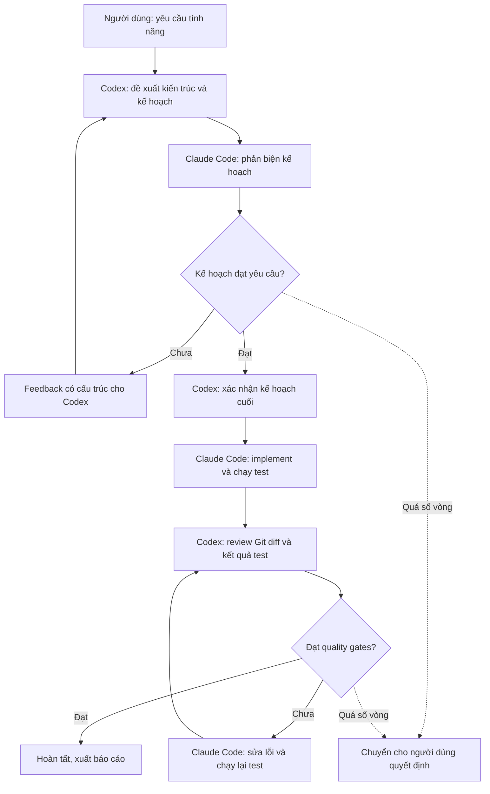
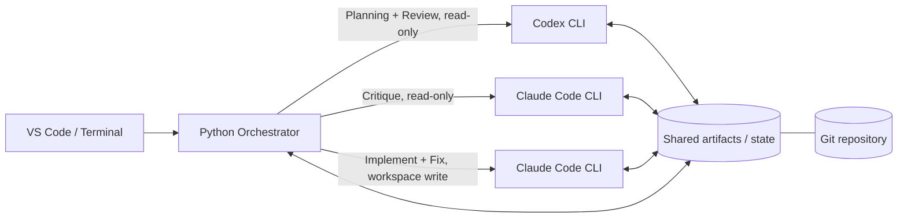
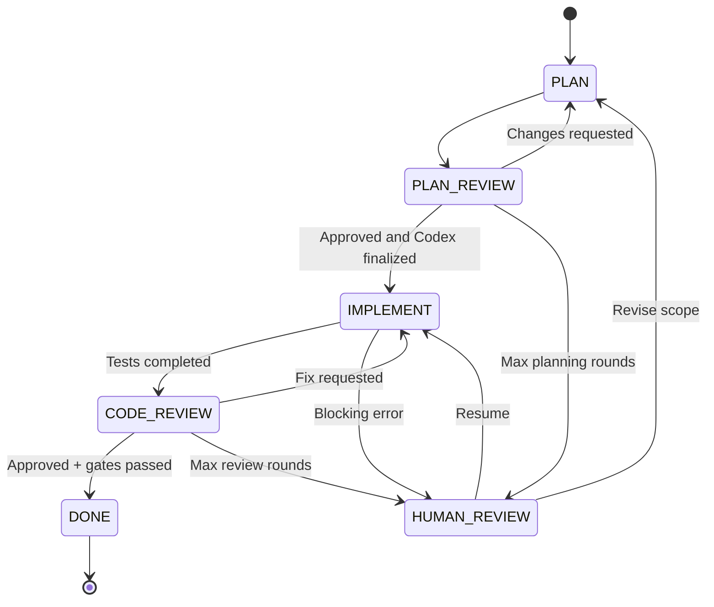

# Kế hoạch Multi-Agent Development: Codex Planner/Reviewer + Claude Code Implementer

## 1. Mục tiêu

Xây dựng workflow tự động trong VS Code/repository, trong đó:

- **Codex**: lên ý tưởng, thiết kế kiến trúc, lập kế hoạch, đánh giá phản biện và review code. **Không sửa source code**.
- **Claude Code**: phản biện kế hoạch về tính khả thi, implement, chạy test, sửa lỗi theo phản hồi.
- **Python Orchestrator**: điều phối vòng lặp, chuyển thông điệp, quản lý trạng thái, giới hạn số vòng và quality gates.

Không yêu cầu hai cửa sổ chat của extension VS Code phải gửi tin nhắn trực tiếp cho nhau. Thay vào đó, dùng **Codex CLI** và **Claude Code CLI** trong cùng repository; hai extension vẫn có thể dùng để quan sát và làm việc thủ công.

## 2. Sơ đồ tổng quan



### Hai vòng lặp

1. **Planning & Debate**: Codex tạo plan → Claude phản biện → Codex cải thiện → lặp đến khi đạt tiêu chí; Codex chốt kế hoạch.
2. **Implementation & Review**: Claude implement → chạy test → Codex review → Claude sửa lỗi → Codex review lại → hoàn tất khi đạt quality gates.

## 3. Kiến trúc kỹ thuật



| Vai trò | Cách gọi dự kiến | Quyền truy cập |
|---|---|---|
| Codex Planner | `codex exec` | Read-only |
| Claude Plan Reviewer | `claude -p` | Read-only |
| Claude Implementer | `claude -p` | Workspace write |
| Codex Code Reviewer | `codex exec` | Read-only |
| Orchestrator | Python `subprocess` | Điều phối và ghi trạng thái |

> **Lưu ý:** CLI và VS Code extension không nhất thiết chia sẻ phiên chat đang mở. Orchestrator giao tiếp với CLI, không điều khiển UI chat của extension. Cần xác minh các tùy chọn CLI/permission với phiên bản cài đặt thực tế trước khi chạy.

## 4. Cấu trúc repository đề xuất

```text
my-project/
├── src/
├── tests/
├── AGENTS.md                   # Hướng dẫn cho Codex
├── CLAUDE.md                   # Hướng dẫn cho Claude Code
└── .orchestrator/
    ├── config.yaml
    ├── state.json
    ├── plan.md
    ├── plan-feedback.md
    ├── review.json
    ├── logs/
    ├── schemas/
    │   ├── plan.schema.json
    │   └── review.schema.json
    └── orchestrator.py
```

Nên thêm file tạm, log nhạy cảm và trạng thái phiên vào `.gitignore` tùy chính sách của dự án.

## 5. Cấu hình điều phối mẫu

```yaml
agents:
  planner: codex
  plan_reviewer: claude
  implementer: claude
  code_reviewer: codex

limits:
  max_planning_rounds: 4
  max_review_rounds: 5

permissions:
  codex: read-only
  claude_planning: read-only
  claude_implementation: workspace-write

quality_gates:
  require_plan_approval: true
  require_tests_pass: true
  require_codex_approval: true
  stop_on_critical_issue: true
```

Đây là **schema tùy chỉnh của orchestrator**, không phải cấu hình mặc định của Codex/Claude Code.

## 6. Hợp đồng giao tiếp giữa agent

Các phản hồi nên là JSON có schema kiểm tra được, không dựa vào việc phân tích câu chữ tùy ý.

### Codex phản hồi kế hoạch

```json
{
  "status": "changes_requested",
  "approved": false,
  "issues": [
    {
      "severity": "high",
      "description": "Missing concurrency control",
      "suggestion": "Add optimistic locking"
    }
  ]
}
```

### Claude phản biện và phản hồi

```json
{
  "status": "feedback_submitted",
  "accepted": ["Add optimistic locking"],
  "disputed": [],
  "proposed_changes": ["Use version-based conflict detection"]
}
```

### Review code (đề xuất mở rộng)

```json
{
  "status": "changes_requested",
  "approved": false,
  "reviewed_commit": "<git-sha>",
  "findings": [
    {
      "severity": "high",
      "file": "src/auth.py",
      "line": 42,
      "issue": "Refresh token is not rotated",
      "recommendation": "Rotate token on refresh and revoke the old token"
    }
  ]
}
```

Mỗi kết quả nên gắn với `task_id`, `round`, `timestamp`, `git_sha` và phiên bản plan để tránh review nhầm trạng thái cũ.

## 7. State machine



**Không được coi việc hai agent đồng ý là bằng chứng code đúng.** Các quality gate độc lập (test, typecheck, lint, security checks tùy dự án) vẫn phải đạt.

## 8. Quy trình triển khai theo giai đoạn

### Phase 1 — MVP CLI Orchestrator

1. Cài Codex CLI và Claude Code CLI, đăng nhập bằng tài khoản tương ứng.
2. Kiểm tra lệnh không tương tác trong repository thử nghiệm.
3. Tạo `orchestrator.py` gọi CLI tuần tự, truyền prompt và ghi kết quả.
4. Áp dụng output JSON/schema và kiểm tra lỗi parse.
5. Giới hạn số vòng; lưu state sau mỗi bước để có thể resume.
6. Chạy thử trên một task nhỏ, chưa cho phép tự động commit/push.

Lệnh cài Codex CLI:

```bash
npm install -g @openai/codex
codex login
```

Ví dụ chạy Codex read-only để khảo sát repository:

```bash
codex exec "Review the current repository architecture. Do not modify files."
```

Ví dụ chạy Claude ở chế độ không tương tác:

```bash
claude -p "Critique the proposed plan without modifying files."
```

> Cần cấu hình sandbox/quyền thực thi thật sự ở mức công cụ, **không chỉ ghi 'do not modify files' trong prompt**.

### Phase 2 — Chất lượng và an toàn

- Thiết lập read-only sandbox cho Codex và Claude ở bước planning.
- Chỉ Claude implementer có quyền ghi workspace.
- Giới hạn thời gian, số vòng, mức sử dụng và số lần retry.
- Chụp `git status`/commit trước và sau từng vòng; tránh ghi đè thay đổi chưa commit của người dùng.
- Chạy test, lint, typecheck bằng lệnh dự án cung cấp; lưu stdout/stderr và exit code.
- Chặn hành động nguy hiểm (xóa hàng loạt, push, deploy, thay đổi secrets) trừ khi được phê duyệt.
- Dừng để người dùng xử lý nếu hai agent bất đồng kéo dài hoặc test liên tục thất bại.

### Phase 3 — Trải nghiệm VS Code

- Bổ sung terminal UI hiển thị tiến độ, vòng lặp, agent đang chạy, lý do reject.
- Có thể thêm MCP server hoặc extension VS Code riêng để quan sát log, phê duyệt và resume.
- Không phụ thuộc vào việc tự động nhập/xuất nội dung của hai khung chat extension.

## 9. Tiêu chí hoàn thành

- [ ] Codex tạo plan có mục tiêu, phạm vi, acceptance criteria và rủi ro.
- [ ] Claude phản biện plan trước khi implement.
- [ ] Codex xác nhận plan cuối cùng.
- [ ] Claude là agent duy nhất chỉnh sửa source code.
- [ ] Codex review diff và kết quả kiểm tra sau implement.
- [ ] Claude xử lý findings, Codex review lại trên revision mới.
- [ ] Test/lint/typecheck bắt buộc đạt; findings nghiêm trọng đã được xử lý.
- [ ] Không vượt quá số vòng; có trạng thái dừng và resume.
- [ ] Có log, báo cáo cuối cùng và danh sách vấn đề chưa giải quyết.

## 10. Ví dụ sử dụng dự kiến

```bash
python .orchestrator/orchestrator.py \
  "Implement JWT authentication with refresh tokens"
```

Ví dụ diễn tiến:

```text
[1/6] Codex       Plan created
[2/6] Claude      Plan critique: 2 issues
[3/6] Codex       Revised plan; approved
[4/6] Claude      Implementation + tests
[5/6] Codex       Review: 1 issue
[6/6] Claude      Fixed -> Codex re-review: approved
[DONE]           Quality gates passed
```

Đây là **minh họa mục tiêu**, không phải output từ chương trình đã được viết/chạy.

## 11. Lưu ý về subscription và chi phí

Có thể dùng các CLI qua phương thức đăng nhập subscription được nhà cung cấp hỗ trợ, tùy điều kiện và giới hạn hiện hành. **Subscription không đồng nghĩa với API key miễn phí hoặc API không giới hạn.** Nên xác minh chính sách sử dụng và các chế độ đăng nhập trên trang chính thức trước khi triển khai.

## 12. Tài liệu tham khảo

- Codex CLI: https://developers.openai.com/codex/cli/
- Codex non-interactive mode: https://developers.openai.com/codex/non-interactive/
- Claude Code documentation: https://code.claude.com/docs/en/overview
- Claude Code CLI reference: https://code.claude.com/docs/en/cli-reference

---

**Kết luận:** Triển khai bằng **Python Orchestrator + Codex CLI + Claude Code CLI** trước; Codex giữ vai trò planner/reviewer, Claude giữ vai trò critic/implementer. Hai vòng lặp có giới hạn, dữ liệu trao đổi có cấu trúc, và các quality gates khách quan quyết định hoàn thành.
